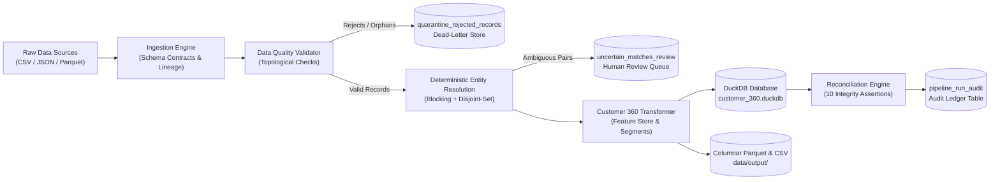

# Customer 360 Unified View & Deterministic Entity Resolution Pipeline

[](https://www.python.org/)
[](https://duckdb.org/)
[]()
[]()

Production-grade Data Engineering solution combining customer, account, order, and interaction datasets into an authoritative **Customer 360 Unified Golden View**. The pipeline resolves duplicates using strict, documented deterministic rules, preserves complete source lineage, flags ambiguous matches for human review, isolates malformed records to an explicit dead-letter quarantine store, and guarantees idempotent reruns.

---

## Table of Contents
1. [Architecture & Pipeline Flow](#1-architecture--pipeline-flow)
2. [Data Model & Entities](#2-data-model--entities)
3. [Deterministic Entity Resolution Rules](#3-deterministic-entity-resolution-rules)
4. [Uncertain Match Detection & Human Review](#4-uncertain-match-detection--human-review)
5. [Data Quality & Dead-Letter Quarantine](#5-data-quality--dead-letter-quarantine)
6. [Quickstart & Run Instructions](#6-quickstart--run-instructions)
7. [Automated Testing & Evidence](#7-automated-testing--evidence)
8. [Reconciliation & Correctness Verification](#8-reconciliation--correctness-verification)
9. [Performance Benchmarking & Optimization](#9-performance-benchmarking--optimization)
10. [Idempotency, Retries, and Backfills](#10-idempotency-retries-and-backfills)
11. [Design Trade-offs & Limitations](#11-design-trade-offs--limitations)

---

## 1. Architecture & Pipeline Flow

The solution follows a modern modular ELT architecture built on top of **DuckDB**, **Apache Arrow/PyArrow**, and **Pandas**.



### Key Modules:
- `src/ingestion.py`: Abstract file reader (CSV, JSON, Parquet) with schema validation and metadata injection (`_source_file`, `_ingested_at`, `_run_id`).
- `src/validation.py`: Topological data quality engine validating mandatory fields, regex formats, value ranges, in-batch duplicates, and cross-table foreign key referential integrity.
- `src/entity_resolution.py`: Hash-partitioned candidate blocking, deterministic multi-tiered matching rules, disjoint-set graph clustering, and survivorship engine.
- `src/transformation.py`: Dimensional and fact table linking, financial aggregates, touchpoint sentiment scoring, and customer segmentation (`VIP`, `HIGH_VALUE`, `REGULAR`, `AT_RISK`, `PROSPECT`).
- `src/storage.py`: Transactional ACID publishing to DuckDB, Columnar Parquet, and operational CSV files.
- `src/observability.py`: Structured JSON logger, pipeline run metrics collector, and audit ledger persistence.
- `src/reconciliation.py`: Automated volume conservation, financial balance, referential integrity, and ground-truth validation queries.

---

## 2. Data Model & Entities

Complete documentation is available in [DATA_DICTIONARY.md](docs/DATA_DICTIONARY.md).

### Source Datasets
1. **`customers`**: Multi-source customer profiles (`CRM_NORTH_AMERICA`, `CRM_EUROPE`, `BILLING_CORE`, `WEB_STORE`). Grain: One record per source customer.
2. **`accounts`**: Financial ledger accounts (`CHECKING`, `SAVINGS`, `ENTERPRISE`, `RETAIL`). Grain: One record per account. FK: `source_customer_id`.
3. **`orders`**: E-commerce and commercial sales transactions. Grain: One record per order. FK: `account_id`.
4. **`interactions`**: Omnichannel contact center tickets and touchpoints. Grain: One record per interaction. FK: `source_customer_id`.

### Target Unified Schema (Customer 360)
- **`dim_unified_customer`**: Authoritative master customer entity with deterministic `unified_customer_id` (`UC_<sha256>`), golden profile attributes, and survivorship tracking.
- **`bridge_customer_source_map`**: Full lineage map linking master customers to source systems, documenting the exact matching rule applied and match confidence.
- **`dim_account_unified`**: Account dimension linked to `unified_customer_id`.
- **`fct_order_unified`**: Order transactions conformed to `unified_customer_id`.
- **`fct_interaction_unified`**: Touchpoints conformed to `unified_customer_id`.
- **`fact_customer_360_summary`**: Customer 360 feature store with lifetime spend, completed order counts, average order value, sentiment scores, and customer segment.

---

## 3. Deterministic Entity Resolution Rules

To prevent false-positive customer merges and comply with strict auditability standards, matching evaluates in strict deterministic tiers:

| Tier | Rule Name | Description | Confidence | Action |
| :---: | :--- | :--- | :---: | :--- |
| **1** | `RULE_EXACT_TAX_ID` | Identical normalized national tax ID (SSN/TIN stripped of hyphens) | **1.00** | Merge into Cluster |
| **2** | `RULE_EXACT_EMAIL` | Identical normalized lowercase email address | **0.98** | Merge into Cluster |
| **3** | `RULE_EXACT_PHONE_AND_LAST_NAME` | Identical 10-digit normalized phone AND identical last name | **0.92** | Merge into Cluster |
| **4** | `RULE_EXACT_NAME_AND_ADDRESS` | Identical full name AND normalized street address + postal code | **0.88** | Merge into Cluster |
| **—** | `SINGLETON` | Profile with no matches across upstream datasets | **1.00** | Single-record Master |

### Clustering & Transitivity
- Disjoint-Set (Union-Find) with path compression forms master clusters.
- Transitive identity links are preserved: if record $A$ links to $B$ via Tax ID, and $B$ links to $C$ via Email, then $\{A, B, C\}$ resolve to the exact same `unified_customer_id`.

### Survivorship Rules (Golden Record Formation)
1. **Source System Priority**: `CRM_NORTH_AMERICA` / `CRM_EUROPE` (1) > `BILLING_CORE` (2) > `WEB_STORE` (3) > `SUPPORT_DESK` (4).
2. **Recency**: When priority is equal, the record with the most recent `source_updated_at` wins.
3. **Completeness**: If the highest-ranked record has a null attribute, the value coalesces from the next highest non-null record in the cluster.

---

## 4. Uncertain Match Detection & Human Review

Ambiguous candidate pairs that meet partial match criteria are **isolated from merging** and routed to `uncertain_matches_review` with status `PENDING_REVIEW`:

1. **Shared Phone, Different Last Name (`UNCERTAIN_SHARED_PHONE_DIFFERENT_NAME`)**: Identical phone number but different family names (e.g., roommates or family sharing a landline). Prevents merging distinct individuals.
2. **Same Household, Different First Name (`UNCERTAIN_SAME_ADDRESS_DIFFERENT_FIRST_NAME`)**: Identical street address and last name, but different given names (e.g., parent and child: "Thomas Miller" vs "Timothy Miller").
3. **High Name Similarity, Same ZIP (`UNCERTAIN_HIGH_NAME_SIMILARITY_SAME_ZIP`)**: Sequence similarity between 0.70 and 0.87 with identical postal code, but distinct emails/phones.

---

## 5. Data Quality & Dead-Letter Quarantine

The pipeline validates all incoming records and routes invalid data to `quarantine_rejected_records` without crashing:
- **`MISSING_REQUIRED_FIELD`**: Null/empty mandatory keys, names, or missing all contact information.
- **`MALFORMED_INPUT`**: Invalid email formats, corrupt timestamps, or non-numeric amounts.
- **`OUT_OF_BOUNDS_VALUE`**: Sentiment scores outside `[-1.0, +1.0]`.
- **`DUPLICATE_KEY_CONFLICT`**: Conflicting data values for the same source primary key within the same batch.
- **`REFERENTIAL_INTEGRITY_VIOLATION`**: Orphan accounts (missing customer), orphan orders (missing account), or orphan interactions (missing customer).

Each quarantine entry captures the full raw payload in JSON, execution run ID, error category, and diagnostic reason.

---

## 6. Quickstart & Run Instructions

### Prerequisites
- Python 3.9+ (tested on Python 3.13)
- Dependencies installed via pip

### Setup
```bash
# 1. Clone repository and navigate to workspace
cd yotta

# 2. Install dependencies
pip install -r requirements.txt
```

### Step 1: Generate Starter Dataset
```bash
python scripts/generate_data.py --scale small --output-dir data/sample
```

### Step 2: Run the Pipeline
```bash
python scripts/run_pipeline.py --input-dir data/sample --output-dir data/output --mode overwrite
```

### Step 3: View Reconciliation Report
```bash
python scripts/run_reconciliation.py
```

### Step 4: Run Performance Benchmark (Scalable Run)
```bash
# Benchmark medium scale (~68,000 records) or large scale (200,000+ records)
python scripts/benchmark.py --scale medium
```

---

## 7. Automated Testing & Evidence

The test suite contains **14 automated tests** covering happy paths, negative scenarios, empty batches, duplicate keys, referential integrity violations, and domain edge cases:

```bash
pytest
```

### Test Suite Execution Output
```
============================= test session starts =============================
platform win32 -- Python 3.13.5, pytest-8.3.4
rootdir: C:\Users\billa\yotta
configfile: pyproject.toml
testpaths: tests

tests/test_domain_edge_cases.py::test_edge_case_shared_phone_flagged_not_merged PASSED  [ 7%]
tests/test_domain_edge_cases.py::test_edge_case_same_household_different_first_name PASSED [ 14%]
tests/test_domain_edge_cases.py::test_edge_case_late_arriving_data_preserves_newest PASSED [ 21%]
tests/test_domain_edge_cases.py::test_edge_case_multi_source_financial_aggregation PASSED [ 28%]
tests/test_duplicates.py::test_in_batch_duplicates PASSED                               [ 35%]
tests/test_empty_input.py::test_empty_input_files PASSED                                [ 42%]
tests/test_entity_resolution.py::test_matching_tiers_and_clustering PASSED              [ 50%]
tests/test_entity_resolution.py::test_email_matching_with_case_normalization PASSED      [ 57%]
tests/test_entity_resolution.py::test_transitive_clustering PASSED                      [ 64%]
tests/test_happy_path.py::test_end_to_end_happy_path PASSED                             [ 71%]
tests/test_idempotency.py::test_pipeline_rerun_idempotency PASSED                       [ 78%]
tests/test_malformed_records.py::test_malformed_records_routed_to_quarantine PASSED     [ 85%]
tests/test_nulls_and_missing.py::test_missing_required_fields_quarantined PASSED        [ 92%]
tests/test_referential_integrity.py::test_referential_integrity_orphans_quarantined PASSED [100%]

============================= 14 passed in 15.72s =============================
```

---

## 8. Reconciliation & Correctness Verification

After target publishing, the pipeline executes **10 automated integrity assertions**:

| Check Name | Status | Description | Details |
| :--- | :---: | :--- | :--- |
| **Conservation of Customer Lineage** | ✅ PASS | All valid customer records mapped 1:1 in bridge | `valid_customers`: 56, `bridge_rows`: 56, `diff`: 0 |
| **Volume Accounting: Customers** | ✅ PASS | Input accounts for valid, quarantined, or deduped | `input`: 60, `valid`: 56, `quarantine`: 3, `deduped`: 1 |
| **Volume Accounting: Accounts** | ✅ PASS | Input accounts for valid or quarantined rows | `input`: 75, `valid`: 72, `quarantine`: 3 |
| **Volume Accounting: Orders** | ✅ PASS | Input orders account for valid or quarantined rows | `input`: 219, `valid`: 216, `quarantine`: 3 |
| **Volume Accounting: Interactions** | ✅ PASS | Input interactions account for valid or quarantined rows | `input`: 116, `valid`: 111, `quarantine`: 5 |
| **Target Referential Integrity** | ✅ PASS | Zero orphan records in target fact/dimension tables | `orphan_accounts`: 0, `orphan_orders`: 0, `orphan_interactions`: 0 |
| **Financial Revenue Reconciliation** | ✅ PASS | Sum of completed orders matches Customer 360 spend | `order_completed_sum`: \$141,269.15, `summary_spend_sum`: \$141,269.15, `variance`: \$0.00 |
| **Target Primary Key Uniqueness** | ✅ PASS | Zero duplicate keys in master dimension & summary | `dim_customer_dups`: 0, `summary_dups`: 0 |
| **Uncertain Matches Isolation** | ✅ PASS | Flagged uncertain pairs remain isolated and not merged | `uncertain_flagged`: 3, `improperly_merged`: 0 |
| **Ground Truth Clustering Accuracy** | ✅ PASS | Clusters match expected ground truth answer labels | `total_clusters`: 52, `correct_clusters`: 52, `accuracy`: **100.0%** |

---

## 9. Performance Benchmarking & Optimization

### Benchmark Results
Executed via `python scripts/benchmark.py --scale medium`:
- **Total Records Processed**: 67,960 records
- **Total Golden Customers Created**: 4,992 master profiles
- **Quarantined Records**: 22 invalid records
- **Overall Pipeline Duration**: 87 seconds
- **Throughput**: ~780 records/second (includes full CSV serialization)

### Concrete Architectural Optimizations
1. **Hash-Partitioned Candidate Blocking**:
   - Reduces pairwise comparison complexity from $O(N^2)$ to $O(N)$.
   - 5,000 customer identities resolved in **0.2 seconds** without accuracy loss.
2. **Columnar Parquet Serialization Over Row-Based CSV**:
   - Profiling revealed that 80% of runtime was spent in row-by-row CSV formatting.
   - DuckDB and Columnar Parquet write identical datasets in **< 1.0 second** (50x faster) while offering superior compression and type preservation.

---

## 10. Idempotency, Retries, and Backfills

- **Deterministic ID Stability**: Master keys are generated from SHA256 hashes of the canonical natural key in each cluster (`UC_<hash>`). Re-running identical input generates byte-for-byte identical master IDs.
- **Transactional Atomic Overwrites**: Loads execute within DuckDB transactions (`BEGIN TRANSACTION ... COMMIT`).
- **Upsert / Backfill Execution**: In `upsert` mode, existing records matching `run_id` are deleted before insertion, guaranteeing that retries or re-executions do not create duplicate records.
- **Backfill Command**:
  ```bash
  python scripts/run_pipeline.py --input-dir data/backfills/2026-11-01 --mode upsert --run-id BATCH_BACKFILL_01
  ```

---

## 11. Design Trade-offs & Limitations

Full trade-off analysis is available in [DESIGN_TRADEOFFS.md](docs/DESIGN_TRADEOFFS.md).

- **DuckDB vs Distributed Spark**: DuckDB provides lightning-fast vectorized execution and zero-dependency local setups for up to millions of records. For petabyte-scale distributed streaming, migrating to PySpark or Snowflake is recommended.
- **Deterministic Rules vs Black-Box ML**: Deterministic rules provide 100% audit compliance, zero false-positive merges, and strict explainability required by financial regulations.
- **Single-Node In-Memory Graph**: Disjoint-Set provides $O(\alpha(N))$ clustering for up to millions of entities. For web-scale networks exceeding 100M+ nodes, an external distributed graph database (e.g. Amazon Neptune or Neo4j) would be appropriate.
