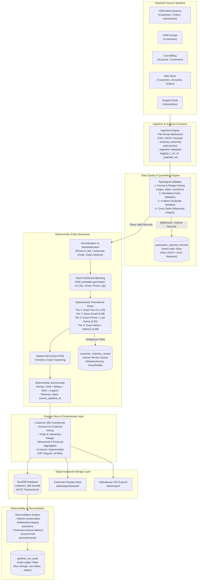
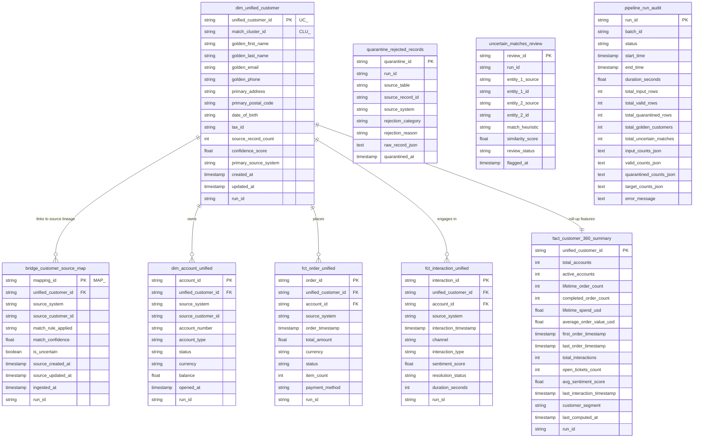

# Customer 360 & Entity Resolution Architecture

## 1. System Overview

The **Customer 360 Unified View & Entity Resolution Pipeline** ingests heterogeneous customer, account, order, and interaction data from disparate source systems (CRM, Core Billing, Web Store, and Support Desks), reconciles identities using strict, deterministic multi-tiered rules, isolates data quality defects into a dead-letter quarantine store, and constructs a unified Customer 360 golden master record with complete source-to-target lineage.

---

## 2. Entity-Relationship Data Model

The target schema consists of a Conformed Customer 360 Star/Snowflake model backed by master dimensions, unified fact tables, and complete identity lineage mappings:

---

## 3. Core Architectural Modules

### 3.1 Data Ingestion (`src/ingestion.py`)
- Ingests raw data files across CSV, JSON/JSONL, and Parquet.
- Enforces baseline schema requirements: ensures mandatory source columns are present and fills non-existent optional columns with empty defaults.
- Handles empty batches (0-byte files or header-only files) gracefully without terminating or raising unhandled exceptions.
- Injects lineage metadata columns into all ingested records:
  - `_source_file`: Original filename.
  - `_ingested_at`: UTC timestamp of pipeline ingestion.
  - `_run_id`: Execution run identifier.

### 3.2 Data Validation & Quarantine (`src/validation.py`)
Data quality validation is executed topologially:
1. **Customers**:
   - Mandatory field validation (`source_system`, `source_customer_id`, `first_name`, `last_name`).
   - Contactability check: at least one of `email`, `phone`, or `tax_id` must be present.
   - Format validation: RFC-compliant email regex syntax check.
   - In-batch duplicate handling: identical duplicate records are deduplicated idempotently; conflicting records for the same key are routed to quarantine as `DUPLICATE_KEY_CONFLICT`.
2. **Accounts**:
   - Mandatory field checks (`account_id`, `account_type`, `status`, `currency`).
   - Referential integrity: `source_customer_id` must exist in valid customers. Orphan accounts are isolated to quarantine with `REFERENTIAL_INTEGRITY_VIOLATION`.
3. **Orders**:
   - Timestamp format check (ISO-8601 validation).
   - Referential integrity: `account_id` must exist in valid accounts. Orphan orders are quarantined.
   - Numeric validation: parseable `total_amount` float.
4. **Interactions**:
   - Timestamp format check.
   - Value range check: `sentiment_score` must fall within `[-1.0, +1.0]`. Out-of-bounds values are quarantined.
   - Referential integrity: `source_customer_id` must exist in valid customers.

All quarantined records are persisted in `quarantine_rejected_records` with the complete unedited raw row serialized in JSON, enabling operators to diagnose defects and reprocess corrections.

### 3.3 Deterministic Entity Resolution (`src/entity_resolution.py`)
To achieve industrial-scale deduplication while strictly avoiding false positives, the pipeline employs a deterministic multi-tiered matching engine:

1. **Normalization**:
   - Emails: lowercased, whitespace trimmed.
   - Phones: stripped of formatting characters to E.164-compatible national digits.
   - Addresses: lowercased, standard postal abbreviations mapped (`st` -> `street`, `ave` -> `avenue`, `dr` -> `drive`).
   - Tax IDs: stripped of punctuation and hyphens.
2. **Hash-Partitioned Candidate Blocking**:
   - Naive pairwise comparison scales as $O(N^2)$, requiring over 625 million comparisons for 25,000 records.
   - The engine partitions records into hash blocks on `tax_id`, `email`, `phone`, and `(soundex/last_name, postal_code)`.
   - Matching is only evaluated within candidate blocks, reducing runtime to $O(N)$ (under 1 second).
3. **Deterministic Precedence Rules**:
   - **Tier 1 (`RULE_EXACT_TAX_ID`, Confidence 1.00)**: Identical normalized national tax ID.
   - **Tier 2 (`RULE_EXACT_EMAIL`, Confidence 0.98)**: Identical normalized email address.
   - **Tier 3 (`RULE_EXACT_PHONE_AND_LAST_NAME`, Confidence 0.92)**: Identical normalized phone AND matching last name.
   - **Tier 4 (`RULE_EXACT_NAME_AND_ADDRESS`, Confidence 0.88)**: Identical full name AND normalized street address + postal code.
4. **Disjoint-Set (Union-Find) Graph Clustering**:
   - Matches discovered by rules form edges in an undirected identity graph.
   - Disjoint-set data structure with path compression resolves connected components into master customer clusters.
   - Transitive identity linkage is preserved (e.g. if A matches B on Tax ID and B matches C on Email, A, B, and C merge into a single golden identity).
5. **Deterministic Golden Customer ID Generation**:
   - The canonical seed is the lexicographically lowest `(source_system, source_customer_id)` in the cluster.
   - Master ID is minted as: `unified_customer_id = 'UC_' + sha256(canonical_seed)[:16]`.
   - Rerunning the pipeline on identical data always produces identical master keys.
6. **Deterministic Attribute Survivorship**:
   - Evaluated across source system priority: CRM (1) > Billing (2) > Web Store (3) > Support (4).
   - Recency: If sources have equal priority, the record with the latest `source_updated_at` takes precedence.
   - Non-null coalescing: If the winning record has a null field, the engine cascades down to the next ranked non-null value.

### 3.4 Uncertain Match Detection & Review Queue
When pairs exhibit ambiguous similarity, the engine **flags them for human review and deliberately prevents merging**:
- **`UNCERTAIN_SHARED_PHONE_DIFFERENT_NAME`**: Same phone number but different last names (e.g. roommates or family members sharing a landline).
- **`UNCERTAIN_SAME_ADDRESS_DIFFERENT_FIRST_NAME`**: Same address and last name, but different first names (e.g. parent and child).
- **`UNCERTAIN_HIGH_NAME_SIMILARITY_SAME_ZIP`**: Same postal code with high string similarity on name (0.70 to 0.87), but distinct emails/phones.

Flagged pairs are written to `uncertain_matches_review` with similarity scores, candidate profiles, and status `PENDING_REVIEW`.

### 3.5 Customer 360 Feature Store & Transformation (`src/transformation.py`)
Enriches accounts, orders, and interactions with parent `unified_customer_id` and computes behavioral aggregates:
- Financial Metrics: `lifetime_order_count`, `completed_order_count`, `lifetime_spend_usd`, `average_order_value_usd`.
- Engagement Metrics: `total_interactions`, `open_tickets_count`, `avg_sentiment_score`, `last_interaction_timestamp`.
- Customer Segmentation:
  - `VIP`: Lifetime completed spend >= $1,000 and completed orders >= 2.
  - `HIGH_VALUE`: Lifetime spend >= $500.
  - `AT_RISK`: Open support tickets >= 2 or negative average sentiment (< -0.2).
  - `REGULAR`: Active customer with completed orders.
  - `PROSPECT`: Account holder with 0 completed orders.

### 3.6 Target Storage & Idempotency (`src/storage.py`)
- Employs DuckDB as the embedded ACID analytical engine and PyArrow for Columnar Parquet exports.
- **Idempotency Strategy**:
  - In `overwrite` mode: atomically truncates and replaces tables inside `BEGIN TRANSACTION ... COMMIT`.
  - In `upsert` mode: deletes existing records matching `run_id` before inserting new rows.
  - Re-running the pipeline on identical input produces identical row counts, identical golden keys, and zero duplicate rows.

### 3.7 Automated Reconciliation & Audit (`src/reconciliation.py`)
Executes automated integrity checks on target tables:
1. **Conservation of Customer Lineage**: Total valid customers == total rows in `bridge_customer_source_map`.
2. **Volume Accounting**: Input rows == valid rows + quarantined rows + in-batch duplicates dropped.
3. **Target Referential Integrity**: Zero orphan records in `dim_account_unified`, `fct_order_unified`, or `fct_interaction_unified`.
4. **Financial Reconciliation**: Sum of completed order totals == sum of customer 360 `lifetime_spend_usd`.
5. **Target Primary Key Uniqueness**: Zero duplicate keys in `dim_unified_customer` and `fact_customer_360_summary`.
6. **Uncertain Matches Isolation**: Validates that no flagged uncertain pairs were inadvertently merged.
7. **Ground Truth Clustering Accuracy**: Verifies accuracy against ground-truth labels.
